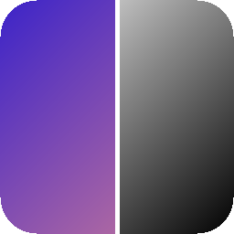

<div align="center">



# ImageLab: Image Processing Lab

A **C++17 / Qt 6** desktop application that implements classic digital image processing algorithms from scratch, without OpenCV, and shows the original and processed images side by side.

[](https://github.com/MatheusQuinteros/FPI/actions/workflows/build.yml)
[](https://github.com/MatheusQuinteros/FPI/releases/latest)
[](LICENSE)


**[⬇️ Download for Windows or Linux](https://github.com/MatheusQuinteros/FPI/releases/latest)**: no installation required.

🇧🇷 [Versão em português](README.md)

</div>

> The user interface is in Portuguese.

---

## Demo

<!--
  To enable: save the captures in docs/ and remove this comment.

<p align="center">
  
</p>

<p align="center">
  
</p>
-->

## Technical highlights

- **Hand-written algorithms** that work directly on the RGB pixel buffer, with no computer vision libraries.
- **Generic 3x3 convolution**, with arbitrary kernels and presets (Gaussian, Laplacian, Prewitt, Sobel) plus high-pass handling (+127 offset).
- **Histograms**: computation, plotting, equalization and *histogram matching* between two images.
- **Geometric transforms**: mirroring, 90° rotation and downscaling/upscaling with interpolation.
- **Qt 6 Widgets GUI**, with parameter dialogs and a side-by-side comparison.
- **CMake build and GitHub Actions CI**, which produce an AppImage (Linux) and a ZIP (Windows) for each release.

## Running

### Option 1: download the executable

From the [Releases](https://github.com/MatheusQuinteros/FPI/releases/latest) page:

- **Windows**: download `ImageLab-windows.zip`, extract it and run `ImageLab.exe`.
- **Linux**: download `ImageLab-x86_64.AppImage`, then run:

  ```bash
  chmod +x ImageLab-x86_64.AppImage && ./ImageLab-x86_64.AppImage
  ```

### Option 2: build from source

Requirements: a C++17 compiler, CMake 3.16 or newer and Qt 6.

```bash
# Ubuntu/Debian
sudo apt install build-essential cmake qt6-base-dev
# Fedora
sudo dnf install gcc-c++ cmake qt6-qtbase-devel
```

```bash
cmake -S src -B build -DCMAKE_BUILD_TYPE=Release
cmake --build build --parallel
./build/ImageLab
```

## Usage

1. Click **Abrir imagem** (Open image) and pick a JPEG file.
2. Choose an operation in the toolbar and click **Aplicar** (Apply).
3. Compare the original and the result. Operations can be chained.
4. Use **Restaurar original** (Restore original) to discard changes, or **Salvar resultado** (Save result) to export a JPEG.

For histogram matching, the opened image is the source, and the app asks for a second image as the reference.

## Features

| Category | Operations |
|---|---|
| Point operations | Grayscale (luminance), quantization, brightness, contrast, negative |
| Geometric | Horizontal/vertical mirroring, ±90° rotation, downscaling and 2x upscaling with interpolation |
| Histogram | Plotting, equalization, matching |
| Filtering | 3x3 convolution with a custom kernel, Gaussian, Laplacian, Prewitt Hx/Hy, Sobel Hx/Hy |

## Project layout

```text
src/
├── main.cpp          # entry point
├── mainwindow.*      # Qt UI and wiring of the operations
├── funcoes.*         # image processing algorithms
└── stb_image*.h      # image I/O (vendored dependency)
.github/workflows/    # CI: build and packaging for Linux and Windows
packaging/            # AppImage icon and .desktop file
```

## Context

Built for the course **INF01046 — Fundamentals of Image Processing** at UFRGS (Federal University of Rio Grande do Sul, Brazil). The assignment brief (in Portuguese) is in [`INF01046_Trabalho_2.pdf`](INF01046_Trabalho_2.pdf).

Licensed under [MIT](LICENSE).
