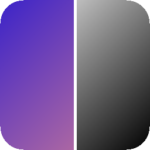

<div align="center">



# ImageLab: Laboratório de Processamento de Imagens

Aplicativo desktop em **C++17 e Qt 6** que implementa do zero, sem OpenCV, algoritmos clássicos de processamento digital de imagens e mostra a imagem original e o resultado lado a lado.

[](https://github.com/MatheusQuinteros/FPI/actions/workflows/build.yml)
[](https://github.com/MatheusQuinteros/FPI/releases/latest)
[](LICENSE)


**[⬇️ Baixar para Windows ou Linux](https://github.com/MatheusQuinteros/FPI/releases/latest)**: não precisa instalar nada.

🇺🇸 [English version](README.en.md)

</div>

---

## Demonstração

<!--
  Para ativar: salve as capturas em docs/ e remova este comentário.
  Sugestão: um GIF curto (10 a 15 s) abrindo uma foto e aplicando Sobel, equalização e rotação.

<p align="center">
  
</p>

<p align="center">
  
</p>
-->

## Destaques técnicos

- **Algoritmos implementados à mão**, com manipulação direta do buffer de pixels RGB e sem bibliotecas de visão computacional.
- **Convolução 3x3 genérica**, com kernels arbitrários e filtros prontos (Gaussiano, Laplaciano, Prewitt, Sobel) e tratamento de passa-altas (offset de 127).
- **Histogramas**: cálculo, visualização, equalização e *histogram matching* entre duas imagens.
- **Transformações geométricas**: espelhamento, rotação de 90° e redução/ampliação com interpolação.
- **Interface Qt 6 Widgets**, com diálogos de parâmetros e comparação lado a lado.
- **Build com CMake e CI no GitHub Actions**, que gera AppImage (Linux) e ZIP (Windows) a cada versão.

## Como executar

### Opção 1: baixar o executável

Na página de [Releases](https://github.com/MatheusQuinteros/FPI/releases/latest):

- **Windows**: baixe `ImageLab-windows.zip`, extraia o arquivo e abra `ImageLab.exe`.
- **Linux**: baixe `ImageLab-x86_64.AppImage` e execute:

  ```bash
  chmod +x ImageLab-x86_64.AppImage && ./ImageLab-x86_64.AppImage
  ```

### Opção 2: compilar a partir do código

Pré-requisitos: compilador C++17, CMake 3.16 ou superior e Qt 6.

```bash
# Ubuntu/Debian
sudo apt install build-essential cmake qt6-base-dev
# Fedora
sudo dnf install gcc-c++ cmake qt6-qtbase-devel
```

```bash
cmake -S src -B build -DCMAKE_BUILD_TYPE=Release
cmake --build build --parallel
./build/ImageLab
```

## Como usar

1. Clique em **Abrir imagem** e selecione um arquivo JPEG.
2. Escolha uma operação na barra de ferramentas e clique em **Aplicar**.
3. Compare a imagem original com o resultado. As operações podem ser encadeadas.
4. Use **Restaurar original** para descartar as transformações ou **Salvar resultado** para exportar em JPEG.

Na correspondência de histogramas, a imagem aberta é a origem, e o programa pede uma segunda imagem como referência.

## Funcionalidades

| Categoria | Operações |
|---|---|
| Pontuais | Tons de cinza (luminância), quantização, brilho, contraste, negativo |
| Geométricas | Espelhamento horizontal/vertical, rotação ±90°, redução e ampliação 2x com interpolação |
| Histograma | Visualização, equalização, correspondência (*matching*) |
| Filtragem | Convolução 3x3 com kernel livre, Gaussiano, Laplaciano, Prewitt Hx/Hy, Sobel Hx/Hy |

## Estrutura

```text
src/
├── main.cpp          # ponto de entrada
├── mainwindow.*      # interface Qt e integração das operações
├── funcoes.*         # algoritmos de processamento de imagens
└── stb_image*.h      # leitura/gravação de imagens (dependência embarcada)
.github/workflows/    # CI: build e empacotamento para Linux e Windows
packaging/            # ícone e .desktop do AppImage
```

## Contexto

Projeto desenvolvido para a disciplina **INF01046 — Fundamentos de Processamento de Imagens**, da UFRGS. O enunciado está em [`INF01046_Trabalho_2.pdf`](INF01046_Trabalho_2.pdf).

Licença [MIT](LICENSE).
